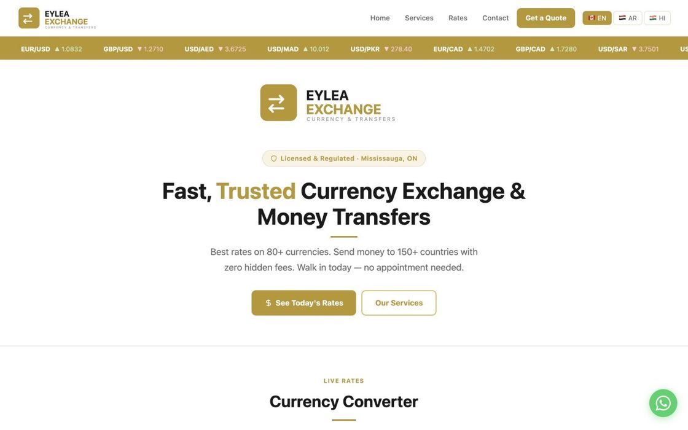

# Eylea Exchange — Business Website

**Live site:** [eyleaexchange.com](https://eyleaexchange.com)

A responsive four-page website for **Eylea Exchange**, a licensed currency exchange and money transfer business in Mississauga, Ontario. I designed and built the site, the brand identity and the deployment from scratch.



## Features

- **Live rates ticker** and **currency converter** covering 25 currencies
- **Four pages:** Home, Services, Rates and Contact
- **Contact page** with a form, Google Maps embed and FAQ
- **Multilingual-ready header** (EN / AR / HI) and a floating WhatsApp button
- **Fully responsive** layout for desktop, tablet and mobile
- **Brand identity:** logo, colour palette and typography

## Tech stack

| Area | Tools |
|---|---|
| Front end | HTML5, CSS3, vanilla JavaScript |
| Hosting | Netlify (custom domain, DNS, HTTPS) |
| Business setup | Google Business Profile, business email forwarding |

## Project structure

```
index.html      Home page: converter, services overview, map
services.html   Full services description
rates.html      Rate table and converter
contact.html    Contact form, map and FAQ
css/style.css   All styles (colours live in :root)
js/main.js      Ticker, converter and navigation
netlify.toml    Netlify configuration
```

## Run locally

No build step. Open `index.html` in a browser, or serve the folder:

```bash
npx serve .
```

## Related

The business also runs on an internal management system I built: [eylea-internal-system](https://github.com/manar-altumah22/eylea-internal-system).

---

Designed and developed by **Manar Altumah** · [Portfolio](https://manar-altumah.netlify.app) · [LinkedIn](https://www.linkedin.com/in/manar-a-4b776030a)
